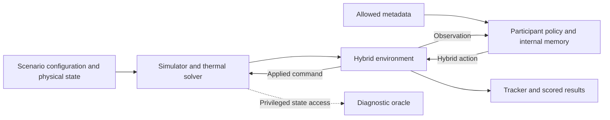

# Repository analysis: evidence, interfaces, and the next validation boundary

Audit date: **2026-10-28**. Repository snapshot: **`2603d8e31eef3465ec54d02e1d62eb4d743c9b93`**.
Scope: local source, generated scenario files, archived results, submission notebooks, and research/day notes.
Closing reconciliation: HEAD advanced concurrently to **`59a307b7aa6d47210c2f921a6b9a0ea7d6428605`**.
Commits `9cd060e` and `59a307b` record occ9 submitted and item 10 closed; these later journal claims are incorporated below.
No simulator episode, training job, benchmark, or test suite was run for this report.
Inventory and selected CSV reductions used `./.venv/bin/python -B`; no policy or simulator files were changed.
This report supplements the five earlier research tracks and supersedes their repository-state claims where dated evidence conflicts.

## 1. Evidence standard and principal findings

**Source-verified** means inspected current code or configuration; it does not certify an old run used that source.
**Recomputed** means this audit read an existing artifact and calculated the stated value without simulation.
**Journal-reported** means a dated experiment/submission claim was found in the lab notebook but not independently reproduced here.
**Hypothesis** means an explanation or proposed experiment, not an established mechanism or attainable score.
Local filesystem presence is weaker than durable provenance: `smart_buildings/results/`, transfer scenarios, and all `*.npz` files are ignored by Git.

The working controller is a substantial stateful rule stack, with learned-policy and thermal-model research beside it.
The repository does not yet contain a demonstrated participant-only MPC controller that improves full-episode transfer scores.
The largest immediate evidence gap is the identity and coverage of recent promising rule combinations, including their comfort tails.
The largest modeling gap is trustworthy counterfactual prediction with delayed sensors and unknown state/material/forcing parameters.

The claim in the original synthesis (now `docs/research/2026-10-27-synthesis.md`) that a leader below our train mean proves a **control gap rather than composition** is unsupported.
Our train scenarios and the hidden evaluation are different distributions; their means cannot identify the cause of a leaderboard difference.
The opposite claim in the `occ_gated5.py` docstring, that the gap therefore lives in hidden composition/weights/quirks, is also unsupported.
Fixed competition reward weights are accepted from `AGENTS.md`; a hidden weight change is not evidence established by this repository.
At the journal's reported public scores, moving from `0.01323` to `0.00521` would require a **60.62%** reduction on that same public evaluation.
The roughly **45.89%** reduction from our recomputed train mean to `0.00521` mixes coverages and is not a valid measured improvement target.

## 2. Snapshot, ownership, and documentation state

The audit started with these existing user-owned changes; they were read and preserved:

| Path | State relative to snapshot | Observed content |
| --- | --- | --- |
| `smart_buildings/baselines/occ_dbh.py` | Modified | Docstring rewording only in the inspected diff |
| `smart_buildings/evaluate.py` | Modified | Import and registration of `OccDcv7Policy` / `occ_dcv7` |
| `smart_buildings/baselines/occ_dcv.py` | Untracked | Occupancy-scheduled recirculation experiment |

SHA-256 at inspection: `occ_dbh.py` = `686a741b43730f6496ec241051b9227ac7d6d88d1d761e31aec2a96a399b9734`.
SHA-256 at inspection: `evaluate.py` = `7538c608f15fa92ed48eef5d426dd38b363961e324fb6bfd1ee0cc287cf5aa23`.
SHA-256 at inspection: `occ_dcv.py` = `e3a64d2c84bbb5c2d1daba3e3c9d28d1a0ad92b5d765215e1af4baf71c0cee52`.
These hashes describe the observed working files, not an approved release or the source of any archived experiment.
At closing reconciliation, `occ_dcv.py` and its evaluator registration had been committed by the concurrent work; `occ_dbh.py` remained modified. The three working-file hashes above were unchanged when rechecked.
`AGENTS.md` makes remote `main` the multi-machine source of truth; this read-only audit did not fetch or verify remote freshness.

`docs/README.md` defines journal, ladder, and template roles plus rules R1–R9; committed prose is English.
`docs/2026/10/28/README.md` is the latest decision record inspected, including an appended overnight October 27 account.
Its initial Summary/Status describes an earlier state than the later Open/Appendix entries; reading only the opening loses the occ8/occ9 updates.
The original research index was dated October 27 and recommended several experiments already completed negatively on October 28; it is now archived as `docs/research/2026-10-27-synthesis.md`.
`tools/simulator_source_audit.md` remains useful for causal ordering, but its statement that the directory has no Git history is historical, not current.
Its numerical source line references also predate the enlarged policy registry; symbols and current files should be used to resolve them.

## 3. Architecture and deployable boundary

| Layer | Local entry points | Responsibility and boundary |
| --- | --- | --- |
| Scenario generation | `tools/gen_transfer.py`, `smart_buildings/run_scenario_generator.py`, `smart_buildings/smart_control/utils/scenario_generator.py` | Build YAML/GIN, floor plans, zone maps, and scenario wiring |
| Local evaluation | `smart_buildings/evaluate.py` | Discover configurations, construct metadata/policy, run tracker, save results |
| Environment | `smart_buildings/smart_control/environment/hybrid_action_environment.py`, `smart_buildings/smart_control/environment/environment.py` | Merge hybrid commands, denormalize, step simulator, return observation/reward |
| Active simulator | `smart_buildings/smart_control/simulator/simulator_flexible_floor_plan.py` | Flexible geometry HVAC/thermal sequencing; do not substitute the base simulator's ordering |
| Physical solver | `smart_buildings/smart_control/simulator/finite_difference_solver.py` | Spatial finite-volume thermal system and implicit air-side coupling |
| Policy library | `smart_buildings/baselines/`, `smart_buildings/evaluate.py::POLICY_MAP` | Stateful policies initialized once per scenario; 138 registered keys in the inspected working source |
| Kaggle transport | `kaggle_evaluation/gateway.py`, `kaggle_evaluation/smart_buildings_inference_server.py` | Metadata delivery, per-scenario policy lifecycle, action transport, scenario return |
| Packaging | `tools/assemble_notebook.py`, `notebooks/` | Copy selected class blocks into standalone submission notebooks |

The diagnostic oracle is a research tool outside the participant interface.
The tracker can retain evidence that was unavailable at action selection time.

The policy interface is `Policy(building_meta_data, action_spec)` followed by `get_action(obs)`.
The inference server creates a fresh policy when the gateway supplies the next scenario's metadata; cross-scenario learned state is not retained by this interface.
The deployable controller receives metadata and the observation, not an environment object, scenario path, material fields, or future weather replay.
Source-based physics priors are permissible architectural knowledge; reading true hidden thermal state or scenario-specific parameters is a separate oracle diagnostic.
`tools/oracle_search.py` and `tools/ckpt.py` deliberately operate outside this boundary and cannot simply be embedded into the submitted policy.

## 4. Observation, action, reward, and time contracts

### 4.1 Variable-size interfaces

For K AHUs and V VAVs, actions are `discrete_action: int32[K+1]` and `continuous_action: float32[3K+2+2V]`.
Discrete values are `{0,1}`; continuous commands are normalized to `[-1,1]`, with zero denoting a range midpoint rather than shutdown.
Plant entries are interleaved; `temp_indices`, `pressure_indices`, `recirculation_indices`, `water_indices`, and `zone_action_indices` must drive indexing.
`zone_action_indices` maps VAV IDs to actuator names; `ahu_zone_assignments` uses room IDs and establishes the zone/AHU relationship.
The AHU contributes SAT, pressure, recirculation and run state; VAVs contribute damper/reheat; the water system contributes temperature, pressure and run state.
Source: `smart_buildings/baselines/transfer_policy.py`, `smart_buildings/evaluate.py::get_action_indices`, and the hybrid environment.

The observation is a building-dependent flat vector addressed by `observation_field_names`.
It includes zone temperatures and bands, achieved damper/reheat positions, AHU states, water-system readings, outside temperature, schedule/time features, and building-level occupancy.
Metadata additionally contains floor/zone maps, floor count, AHU assignments, schedule windows/timezone/holidays, and normalization metadata.
Materials, diffuser arrays, hidden slab/wall temperatures, future weather, and per-zone occupancy trajectories are not exported by `create_building_meta_data`.
The template's `building_train_8` observation-size example says 271; `eda/buildings.csv` records 283. Treat dimensions as metadata, not stable constants.
Likewise, `eda/observation_normalization_metadata.json` is an example artifact, not a substitute for the scenario's live metadata.

`evaluate.py::validate_action` casts dtypes and checks shapes; it does not itself establish finite values or enforce numeric bounds.
The submission interface requires in-range actions, so local shape acceptance is not sufficient submission validation.
Achieved actuator values can differ from commands because the simulator applies physical floors/caps.
Building occupancy also needs its actual normalization contract: `environment.py` uses `(N-c)/(c+1)`, while `evaluate.py` sets an underscored attribute distinct from the public constant used there.
`tools/simulator_source_audit.md` documents that mismatch; assumptions about raw counts must be bound to a particular source/dump version.

### 4.2 Accepted plant and scoring constraints

The following are accepted verified facts from `AGENTS.md`, not new deductions from this audit.
AHUs have cooling only; VAV reheat supplies all heating. Discharge is capped at `308.15K`, recirculation at `0.70`, and dampers at a `10%` minimum.
Reward weights are comfort/energy/carbon = `(0.6, 0.2, 0.2)`; comfort violations have a much steeper penalty than marginal energy savings.
Electricity peak/night is `1.25x`; price-arbitrage load shifting is a closed lever. Boiler efficiency is constant and chiller COP is `3.5`.
Occupancy is building-level only, so direct per-zone occupancy gating is unavailable. Valid scenario sizing requires at most 10 zones/AHU.
Full scoring episodes have **8640 steps**, each **300 seconds**; deterministic reruns do not provide independent statistical replicates.
Loss from a completed CSV is exactly `abs(df.agent_reward.sum()) / len(df)`; scenario means receive equal weight in a suite mean.
Do not pool rows from unequal horizons and label their average a competition score.
The comment in `kaggle_evaluation/gateway.py` describing reward as bounded in `[-1,0]` conflicts with the documented unbounded comfort tail; do not use it as a safety bound.

### 4.3 Causal timing is a model requirement

`SimulatorFlexibleGeometries.execute_step_sim` reads physical zone means and latches VAV sensors before solving the new thermal field.
It then applies equipment/heat inputs, solves, applies room-air convection, and advances the clock without refreshing those VAV temperatures.
Consequently `obs[t+1]` reflects action `u[t]` in actuator readings, but its zone temperatures still represent the preceding physical state.
The thermal response to `u[t]` first appears in the zone sensor at **`obs[t+2]`**; reset produces a duplicated initial temperature observation.
At a forecast origin, propagate the pending previous action first; the newly proposed action only affects the second sensor forecast step.
Reward uses post-solve physical zone means and its own occupancy/setpoint interval, so reward-temperature labels are not interchangeable with the latched observation.
Weather observations and water-system reads also have their own timing semantics; later reported water temperature must not leak into an earlier forcing reconstruction.
Primary local references: `simulator_flexible_floor_plan.py::execute_step_sim`, `_get_zone_reward_infos`, and `tools/thermal_state_observer_notes.md`.
`tools/test_simulator_source_contract.py` and `tools/test_thermal_state_observer_check.py` contain relevant contract tests; their suites were not rerun for this report.

## 5. Scenario and artifact inventory

### 5.1 Train and transfer coverage

Filesystem inventory found **30 train configurations**: buildings 1, 2, 4, 5, 7, 8, each with one strip from Atlanta, Denver, Fairbanks, Phoenix, and Singapore.
These are assigned strips, not a complete cross product of six buildings with every available weather YAML.
Exact pair inventory is reproducible from `smart_buildings/training_scenarios/*/*/config.gin`; the paired weather summary is `eda/weather_strips.csv`.
Parsing the GIN `ahu_N_rooms` lists gives the following generated building inventory without constructing an environment:

| Building | Zones | AHUs | Maximum zones/AHU |
| --- | ---: | ---: | ---: |
| `building_train_1` | 39 | 4 | 10 |
| `building_train_2` | 85 | 9 | 10 |
| `building_train_4` | 54 | 6 | 10 |
| `building_train_5` | 79 | 8 | 10 |
| `building_train_7` | 36 | 4 | 10 |
| `building_train_8` | 30 | 3 | 10 |
| `building_xfer_1` | 29 | 4 | 10 |
| `building_xfer_2` | 61 | 8 | 10 |
| `building_xfer_3` | 17 | 5 | 6 |
| `building_xfer_4` | 125 | 13 | 10 |

The transfer directory contains **16 configurations**, four buildings times `minneapolis_1`, `minneapolis_5`, `atlanta_4`, `singapore_2`.
`tools/gen_transfer.py` uses seeds `50000..50003`, four constructions, and `max_zones_per_ahu=10`; building YAMLs are in `smart_buildings/buildings_xfer/`.
Minneapolis is a held-out station relative to train; Atlanta/Singapore strips change months at already-seen stations.
The generated actual AHU counts can exceed the sampled requested count because the per-AHU zone ceiling must be satisfied; inspect generated assignments.
The journal's **transfer-12** is a completed subset, not the total generated inventory: `building_xfer_2` timed out at 1500 seconds in the described later runs.
All inventoried configurations satisfy the stated zone ceiling; that alone does not guarantee a timeout-free run or representative hidden coverage.
Repeated optimization against this same transfer suite also makes it development data; a new frozen holdout is needed for confirmatory generalization claims.

### 5.2 What is actually stored locally

Under `smart_buildings/results/`, the audit found **1136 `reward_components.csv`**, **1136 `summary.json`**, **31 `scenario_meta.json`**, and **468 NPZ files**.
The NPZ inventory comprises 192 observation dumps, 150 token datasets, 90 DAgger label files, and 36 slot checkpoints; eight `.pt` files also exist.
Summary-declared episode lengths are: **64 × 8640**, **1063 × 864**, **5 × 288**, **2 × 576**, and **2 × 2** steps.
Those counts were read from summaries; this report did not independently recount every CSV row or verify every summary against its CSV.
For `occ_gated4`, all **30** CSVs were read, each contains 8640 rows, and their equal-weight mean is **`0.009628636765325417`**.
Its mean weighted contributions are comfort `0.00037076`, energy `0.00479976`, carbon `0.00445811`: **3.850576% / 49.848852% / 46.300572%**.
This confirms the earlier roughly 96% energy/carbon decomposition on **occ_gated4 train-30**, not on hidden scenarios or the latest candidate.
A large energy share does not establish that the same share is avoidable: comfort-preserving ventilation/heating/cooling can have unavoidable cost.

No canonical summary directories were found for `occ_gated7`, `occ_econdbh7`, or `occ_econdbhhot9` under that results root.
This is a storage/provenance gap, not evidence that those policies were never evaluated: recent full runs exist under `/tmp`.
`/tmp/dm1` has 24 full CSVs; recomputed hard-cell-8 means are occ7 `0.016157327656207122`, dual-max `0.01696358643371738`, and hdamp085 `0.016288041705699127`.
`/tmp/csh` has eight full CSVs; hot-cell-4 means are occ7 `0.009750675770859033` and coolshift7 `0.009672823510725462` (**−0.7984%** on the ratio of suite means).
`/tmp/occ9` has six full candidate CSVs; for example `building_train_1/atlanta_2/occ_econdbhhot9/reward_components.csv` gives **`0.004166675`** when rounded to nine decimals.
These files support arithmetic, but directory names alone do not establish the source commit, environment knobs, or contemporaneous baseline identity.
`/tmp/combo` contains hot-cell `occ_prop7` losses consistent with an earlier variant, rather than the v3 values in the latest journal; do not silently join them by policy key.
Temporary directories are fragile local evidence and should be archived with source/config/parameter identity before future synthesis relies on them.

## 6. Policy families and current release evidence

`zone_pi.py` contains the large PI/SAT/water-reset family; `occ_gated.py` through `occ_gated4.py` add occupancy shutdown, adaptive prestart, latches/floors and water-floor removal.
`occ_gated7.py` inherits occ4 and adds occupied-only starvation-triggered static-pressure trim/respond; occ6 also responds during prestart and had recorded misfires.
`occ_econ.py` explicitly arbitrates cooling economizer recirculation during PI operation, where the inherited branch can leave free cooling unused.
`occ_dbh.py` implements heating-only deadband plus integral leak; this is distinct from the rejected symmetric edge-riding policy in `occ_edge.py`.
`occ_heatopt.py` uses live water/pressure/outside observations and coil-inspired airflow caps, with optional pressure increases for saturated heating zones.
Its fixed flow/pressure/Kv constants and approximated return/mixing calculation are source-based assumptions, not complete identification of unseen equipment or a full shared-flow simulator.
`occ_econdbh.py` combines econ and heating deadband; `occ_econdbhhot9.py` adds HeatOpt through mixin composition.
`occ_dcv.py` was untracked at the initial audit and committed by `59a307b`; the closing journal reports it inert on the four named cells. That later result was not independently rerun here.

The inspected October 28 journal reports public occ4/occ7 **0.01323**, occ6 **0.01337**, and leader **0.00521**.
These are dated journal records; no live Kaggle status or score was fetched for this report.
The initial journal reported occ8 (`occ_econdbh7`) submitted and occ9 held because midnight comfort tails increased. Commit `9cd060e` subsequently records occ9 submitted too, with both scores pending; no live Kaggle check was performed.
Occ8's reported full atlanta_2 notebook/repository equality is a journal claim, not a check rerun here.
The six-cell occ9 results are encouraging matched-cell research evidence, not full train-30, full transfer-16, or confirmed hidden improvement.

Several newer experiment mixins read environment variables (`ECON_ON`, `DBH_*`, `HOPT_*`, and others), including classes copied into candidate notebooks.
`AGENTS.md` requires promoted policies with fixed constants and no environment variables; deterministic defaults do not remove that packaging discrepancy.
Before calling such a candidate a frozen release, record its effective settings and reconcile the shipped class with that repository convention.
The audit does not change or promote these user-owned policies.

## 7. Learning and model diagnostics: what they establish

| Tool family | Existing implementation/evidence | Established limit |
| --- | --- | --- |
| Neural imitation | `smart_buildings/nn_model.py`, `tools/bc_train.py`, `tools/nn_tokenizer.py`, `baselines/nn_policy.py` | Shared room/AHU/global token architecture, history window, held-building imitation split; cloning loss is not closed-loop transfer loss |
| DAgger | `tools/dagger_collect.py`, archived `dagger_labels.npz` | Teacher labels on visited states; preserves teacher limits and needs exact teacher/version provenance |
| Slot regression/hybrid | `tools/slot_train.py`, `baselines/slot_linear.py`, `baselines/slot_hybrid.py` | Per-device continuous heads; hybrid retains rule modes/run bits to avoid shutdown imitation failures |
| PPO | `tools/slot_ppo.py`, local `slot_runs/` checkpoints | Continuous-head fine-tuning exists; no fresh improvement claim follows from checkpoint presence |
| Action-conditioned greybox | `baselines/causal_greybox.py`, `tools/greybox_check.py`, `tools/greybox_audit.py` | Delayed/calibrated variants and persistence comparisons; documented gates remain unmet |
| Equipment reconstruction | `baselines/equipment_balance.py`, `baselines/equipment_observer.py`, `tools/equipment_observer_check.py` | Separate accepted action, achieved actuator, water, and heat-flow effects before fitting thermal state |
| Reduced thermal models | `baselines/zone_thermal.py`, `baselines/thermal_greybox.py`, `baselines/pooled_greybox.py`, `tools/modular_thermal_check.py` | Diagnostic state/forcing models, not a validated deployed planner |
| Spatial reference/reduction | `tools/thermal_grid_reference.py`, `tools/thermal_reduction_check.py`, `tools/thermal_spatial_check.py`, wall/port/system-mode checks | Known synthetic systems isolate topology and reduction error; oracle materials/inputs do not imply participant transfer |
| Causal observer/identification | `tools/thermal_state_observer_check.py`, `tools/thermal_mismatch_check.py`, `tools/thermal_prefix_identification_check.py`, `tools/thermal_family_check.py` | Prefix isolation is enforced, but physical identifiability, no-regression, and interval coverage remain unresolved |
| Adequacy monitoring | `tools/thermal_adequacy_check.py`, `tools/thermal_adequacy_notes.md` | Useful innovation/change detection; not yet a complete reliability certificate |
| Branching oracle search | `tools/oracle_search.py`, `tools/ckpt.py` | True-environment snapshots and CEM expose local headroom; snapshot access/future rollout is unavailable to a participant policy |

Paths abbreviated as `baselines/` in this table are under `smart_buildings/`; local `slot_runs/` is under `smart_buildings/results/`.
`tools/simulator_source_audit.md` identifies missing dynamic walls, neighboring-zone coupling, distinct spatial air/reheat application, and latent thermal history as model-reduction issues.
Its findings reject the assumption that one zone temperature plus one passive mass is an exact Markov state for the executed spatial simulator.
`tools/thermal_state_observer_notes.md` reports accurate two-sensor forecasts on a known 164-state fixture reduced to 13 states, using conditional known future inputs.
`tools/thermal_prefix_identification_notes.md` then records nominal h12 regression from **0.000908 K to 0.006115 K**, despite prefix fit improvement; point fitting is not promoted.
`tools/thermal_family_notes.md` records failed noise/out-of-prior coverage; `tools/thermal_adequacy_notes.md` explicitly stops short of a complete reliability gate.
These are documented diagnostic results, not fresh audit measurements; a source-hashed adequacy manifest exists at `smart_buildings/results/thermal_adequacy_v2_manifest.json`.
The useful next modeling gate is causal, held-out action-response adequacy with allowed inputs, not immediate conversion of those synthetic errors into an MPC savings forecast.

## 8. Evaluation and submission failure modes

`tools/fullrun.py` and `tools/fullrun_t.py` are the authorized full-episode batch drivers; use 8640 steps, aggregate concurrency at most 10, and 1500s+ timeouts.
Their readers calculate the correct loss but do not assert `len(df)==requested_steps`; independent completeness validation is required before comparing a suite.
`tools/parallel_eval.py` is explicitly a screen of at most 288 steps and rejects mismatched summary lengths; it is not a leaderboard surrogate.
The first-line claim in `fullrun.py` that `evaluate.py` has no step cap is stale: the driver itself passes `--steps` to the current evaluator.
`evaluate.py::run_policy` starts its step timer after policy inference, so `seconds_per_step` does not certify total controller runtime overhead.
Policy source must stay frozen while any corresponding evaluation is in flight; subprocesses import independently and can otherwise create a mixed-version suite.
Record incomplete/timeout cells explicitly, including their denominator; a 12-cell transfer mean must not be labeled transfer-16.

The assembler copies requested class blocks verbatim and only selects uppercase assignment lines for `<consts>`.
It is not a dependency resolver: inherited base classes, helper functions, lower-case constants, imports, and the old chain cell still require review.
Always include `occ_gated:<consts>` for `STEPS_PER_HOUR`; the documented missing-constant error arose outside a 12-step smoke window.
Use the required **300+ step** local notebook execution check and retain an action/return equality comparison with the exact frozen repository policy.
The committed candidate notebooks include `smart-buildings-submission-occ8.ipynb` and `smart-buildings-submission-occ9.ipynb`; notebook existence is not proof of submission acceptance.
The authorized flow remains `kaggle kernels push` → wait COMPLETE → `competitions submit -k ... -v N -f submission.parquet`, subject to daily budget and delayed scoring.

## 9. Reconcile the old plan before collecting more results

| Earlier research recommendation | October 28 evidence/status | Current interpretation |
| --- | --- | --- |
| Naive dual-max output swap | Recomputed hard-cell-8 mean increases about 4.99%; 600-step sign reversed | Closed in tested form; retuning is a different hypothesis |
| Symmetric edge riding | Journal: closed; gentle-center variant banked around 1% | Do not generalize closure to heating-only deadband, which has separate gains/tails |
| Blanket prestart shape/timing cuts | Journal: morning comfort losses, including Denver failures | Fixed cuts closed; adaptation requires a new mechanism and evidence |
| Satcap/backlog first | Journal: fair-port satcap loses on heating anchors | Not an unrun priority anymore |
| OAT margin optimal start / evening coast | Journal: both tested forms lose | Do not present vendor analogy as an untested near-certain gain |
| Two-stage G36 SAT | Journal: Singapore around +22%, quantized hunting | Tested form closed; rogue-zone changes do not explain this systematic failure |
| Occupancy proportional effort | Journal: v3 small banked win; earlier versions fail hot/cold cells | Preserve version identity; the same key names multiple experiments |
| AHU staging | Journal: v1 harmful, revised variant largely inert | Low current priority without a different triggering mechanism |
| Coolshift | Recomputed hot-cell-4 mean −0.7984% | Small local result; combinations need separate measurement |
| Economizer / heating deadband / HeatOpt | Journal and selected full CSVs support local improvements; tails persist | Highest-value current evidence collection is frozen combined-policy coverage and risk attribution |
| Pseudo-DCV | Closing journal: sg1 ON bit-identical to occ7; phx6/atl2/den2 loss-equal | Tested variant closed as inert; independent current-source replay not performed here |
| Full MPC / learned residual | Diagnostic models and privileged oracle headroom exist | Require causal model/deployment and full-horizon transfer gates first |

## 10. Concrete collection needs

1. Preserve recent temporary outputs with a manifest naming policy/base source hashes, commit plus dirty diff, effective environment settings, scenario hashes, start time, row counts, failures, and wall time.
2. Build one exact comparison matrix for occ7, econ-only, heating-deadband-only, occ8, and occ9 on identical complete scenarios; retain mean loss, worst cells, occupied comfort tails, and energy/carbon components.
3. Extend beyond the six selected occ9 cells to full train-30 and a declared completed transfer suite, then reserve a fresh building/weather holdout before further tuning.
4. Attribute midnight tail changes using aligned temperature/reward/occupancy timing and paired per-zone diagnostics; aggregate energy share cannot resolve the tradeoff.
5. Save Kaggle kernel/version/submission timestamps and resulting scores as durable artifacts; the current audit has only the dated journal's public-status evidence.
6. For models, archive source-matched observation/action/reward dumps with pending-action alignment, prefix-only fitting boundaries, no hidden-state reads, and action-perturbation evaluation separate from conditional future-input forecasts.
7. For oracle teachers, retain candidate action sequence, privileged information label, objective horizon, reseeding policy, and a deployment-feasible distillation/validation protocol; local CEM improvement is not a 30-day policy score.
8. Reconcile frozen notebook constants, dependency closure, 300+ step execution, full-policy parity, and end-to-end runtime before the next release.

Reproduction basis for this audit: filesystem glob inventories; AST inspection of `POLICY_MAP`; `summary.json::total_steps` counts; GIN room-list parsing; and direct pandas reductions of the named full CSVs.
The closing journal also drops an unimplemented warmest-zone SAT variant using external-notebook evidence and a hot-port result. This is a prioritization decision, not a proof that cooling SAT is globally optimal.
No new score, hidden-state inference, remote status, or blanket claim that a research idea can close the leaderboard gap is established here.
